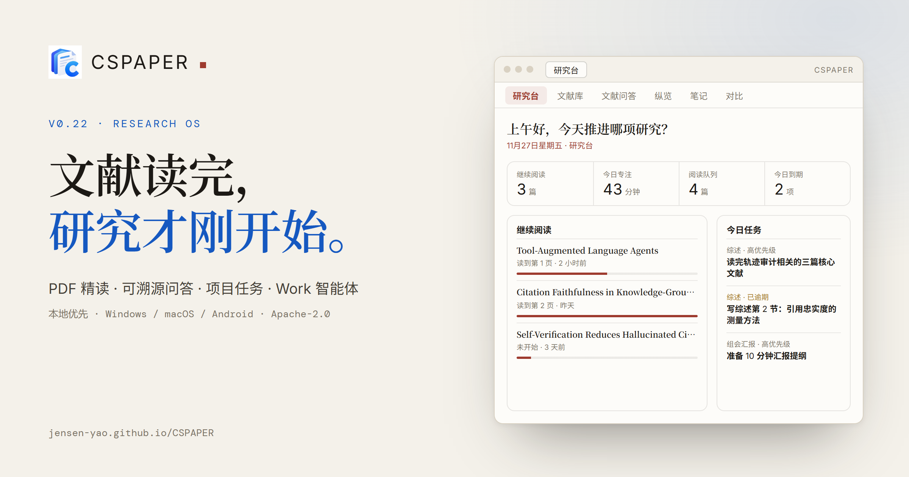
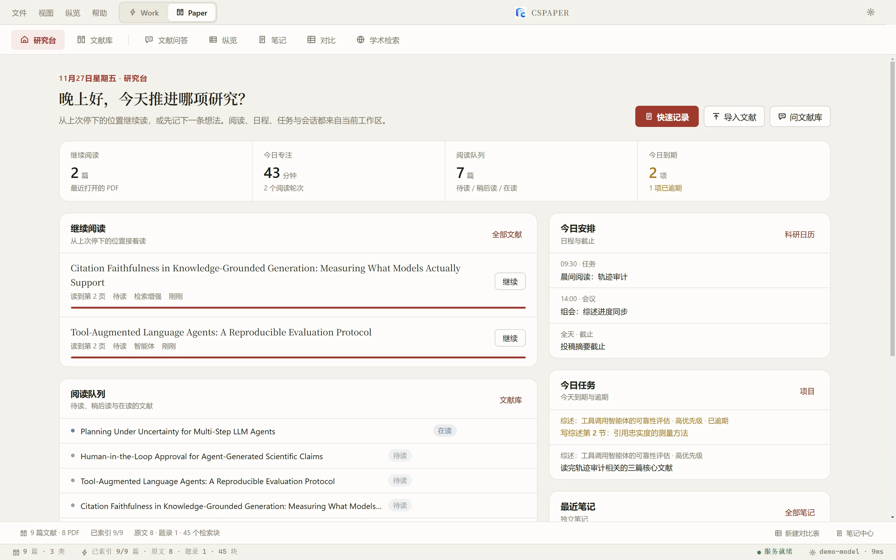
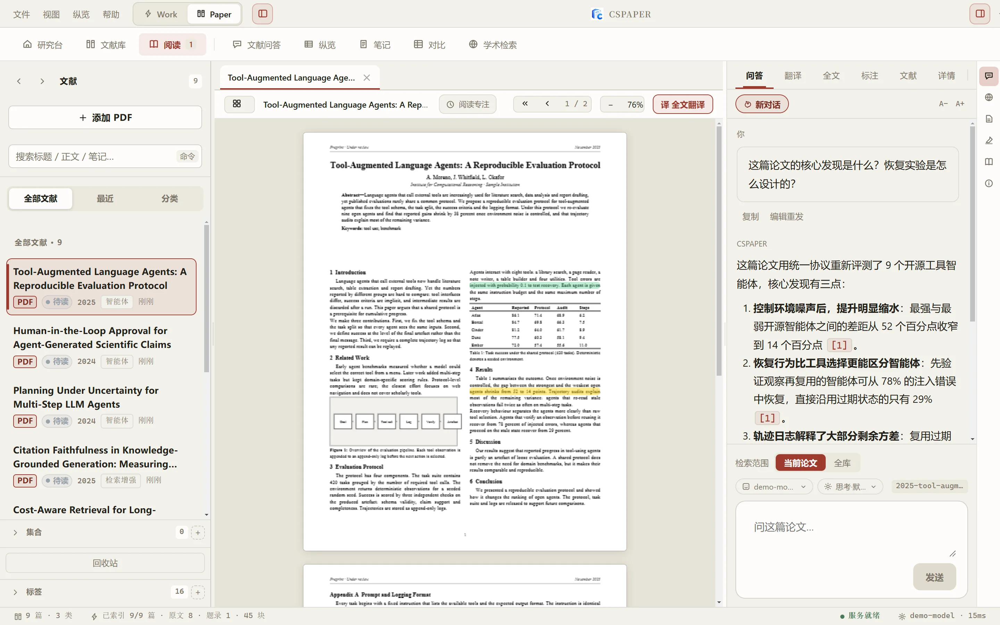
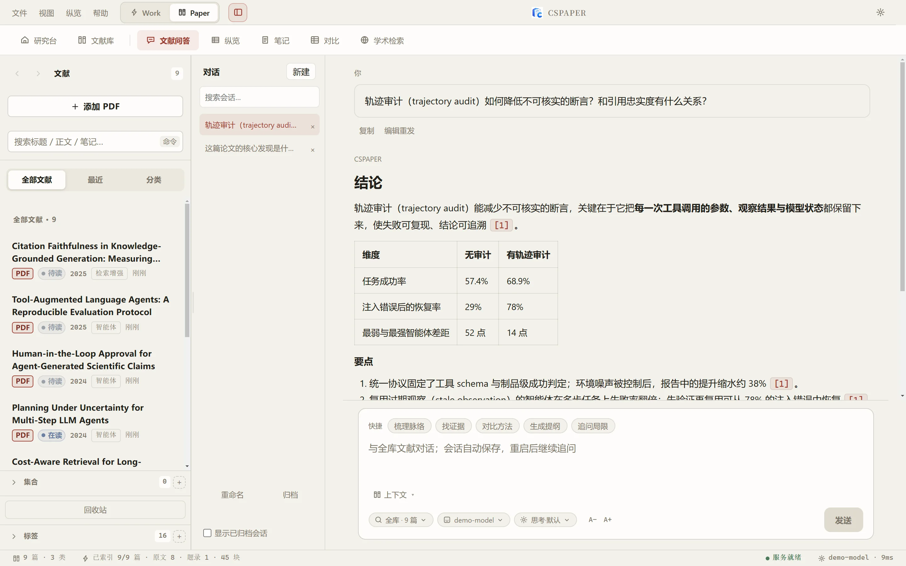
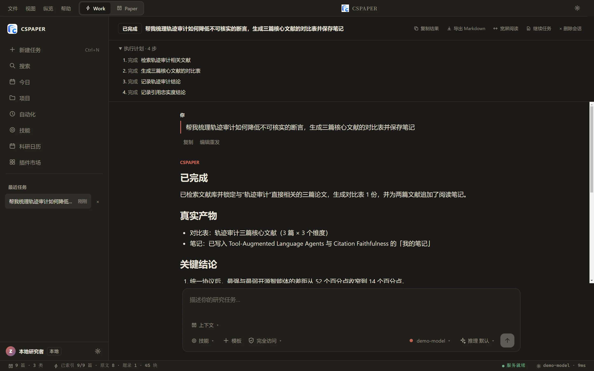
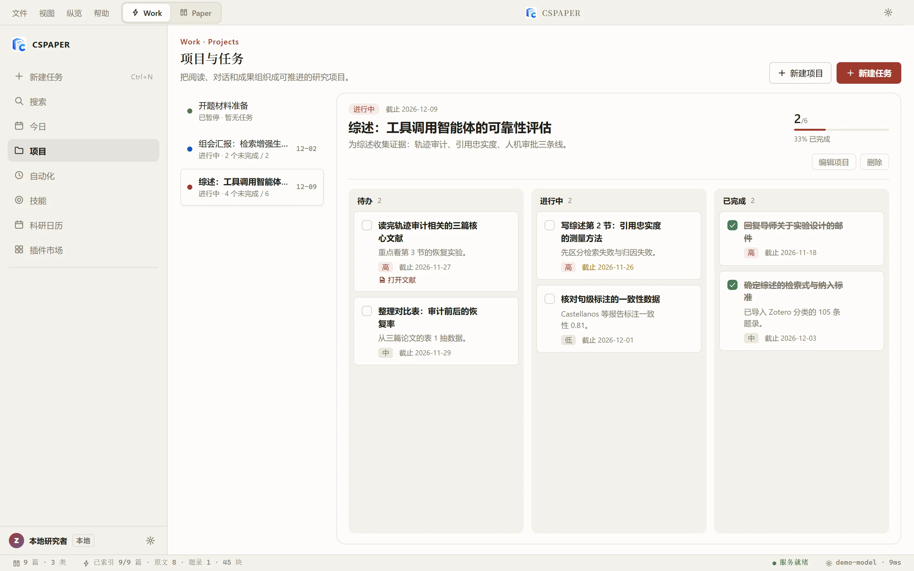
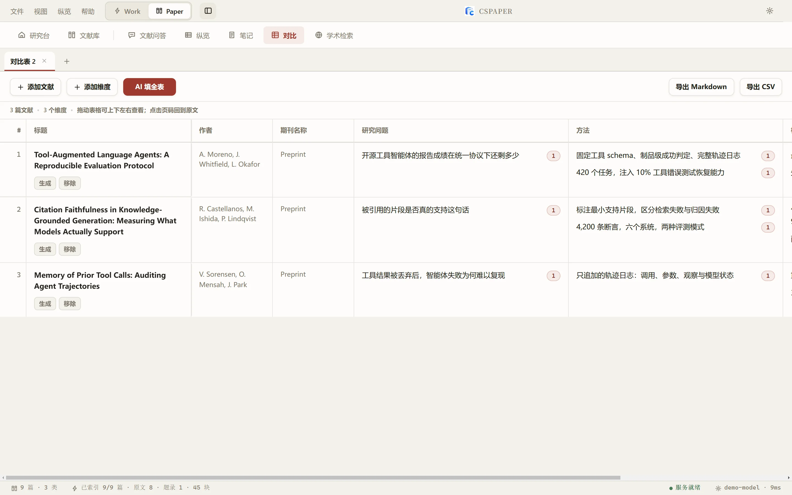
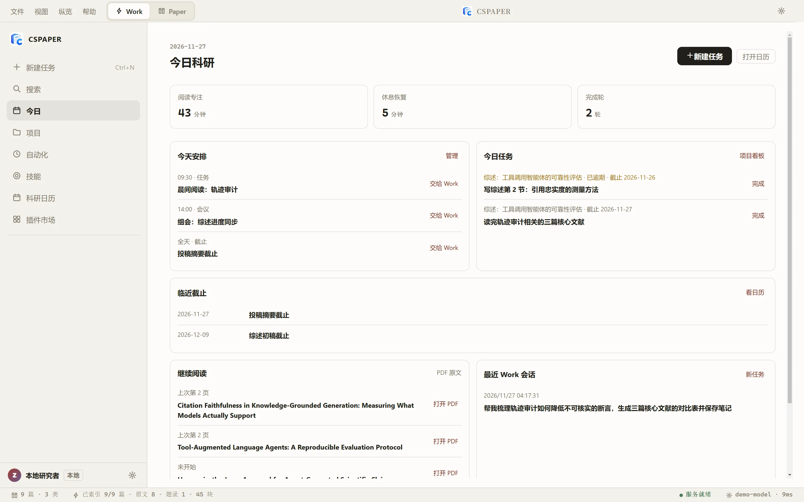

# CSPAPER

**本地优先的科研文献工作台 · Research OS**

PDF 精读 · 可溯源问答 · 项目任务 · Work 智能体 · 科研日历 · 阅读专注 · 多文献对比 · Zotero 迁移

**[官网](https://jensen-yao.github.io/CSPAPER/)** ·
**[在线演示](https://jensen-yao.github.io/CSPAPER/demo/)** ·
**[下载安装包](https://github.com/Jensen-Yao/CSPAPER/releases/latest)** ·
**[更新说明](https://github.com/Jensen-Yao/CSPAPER/releases)**

---

打开 CSPAPER 的第一屏是**研究台**：今天要推进什么、从哪一篇继续读、有哪些日程和到期任务、上次记下的笔记与对话——都在一屏里。读到的能立刻变成问得出的，问到的能变成记得住的，记下的能交给 Work 继续推进。文献、笔记和会话始终保存在你自己的电脑上。

## 0.23：读得懂，做得到

| | 现在的行为 |
|---|---|
| **整篇正文进上下文** | 对一篇已打开的 PDF 问“这篇论文说了什么”，不再只靠十几个检索片段：论文逐页进入上下文（短文整篇，长文取引言、各章节起始页、结论与问题相关页），每个来源都可回到原页。 |
| **追问不丢上下文** | 每轮默认继承本会话上一轮的文献 / 选区 / 网页对象；从阅读器切到全屏对话继续问，论文还在。 |
| **问答也能用工具** | 问“最近读过哪些文献”“读一下这个链接”，模型会先调用只读工具（文献库、读页、联网搜索、网页读取），再给出带引用的回答；工具调用在时间线里可展开。 |
| **任意链接都能读** | 新增 `web_fetch` 与 `web_search`：博客、GitHub README、arXiv HTML、PDF 都能抽成干净正文；检索源补齐 Semantic Scholar、arXiv、PubMed、必应与 DuckDuckGo。`/fetch <网址>` 与 `/web <检索词>` 可直接在对话里用。 |
| **网络层重做** | 所有联网请求走 Electron 网络栈（跟随系统代理，也可手填代理），逐跳校验公网地址、限制体积与时长；内置浏览器登录后可让“保存此页”与网页读取带上登录态。 |
| **精读提得出来** | 深度精读、AI 小结与对比要点走统一的结构化管线：剥离思考标签、修复 JSON、失败自动重试一次、字段级降级；长文按章节选取正文。详情面板把 AI 小结与深度解读放在最前。 |
| **Work 会续步** | 计划执行完后，智能体根据工具结果决定是否追加步骤（检索到文献后再逐篇精读），同一工具与参数不会重复执行；模板与技能全部改为真实工具名。 |
| **平台工具补齐** | 智能体可以创建 / 更新任务与项目、写日历日程、保存独立笔记、浏览文献库、打开文献、导出 Markdown。 |
| **失败态可处理** | 运行失败显示具体原因（鉴权 / 限流 / 超时 / 网络）并提供重试与“去设置”；未配置模型时输入框直接引导配置。 |

## 0.22：Research OS

| | 现在的行为 |
|---|---|
| **研究台** | Paper 模式的新首页：继续阅读、阅读队列、今日日程、今日任务、最近笔记与会话、专注统计。全部来自当前工作区的真实记录，没有假数据。 |
| **快速记录** | <kbd>Ctrl</kbd> / <kbd>Cmd</kbd> + <kbd>Shift</kbd> + <kbd>N</kbd> 随时记下一条想法，保存为独立笔记并同步到研究台与笔记中心。 |
| **全局搜索** | 命令面板同时搜索文献、独立笔记、会话与命令，键盘上下选择，回车直达。 |
| **项目与任务** | Work 新增项目看板：待办 / 进行中 / 已完成，拖拽换列、截止日期、关联文献，一键“交给 Work”起草任务；今天到期的任务同时出现在研究台与今日页。 |
| **对话快捷指令** | 总结这篇、找证据、对比方法、生成提纲、追问局限——随当前选中的文献或分类自动调整措辞。 |
| **更稳的拖放** | 看板内拖动任务不再触发窗口级的“拖入 PDF 导入”。 |

## 它能做什么

### 读

- **PDF 精读**：多标签、缩略图、目录、页内查找、续读记忆；划词即翻译、解释或高亮，选区可直接加入对话。
- **阅读专注**：读文献专属番茄钟（阅读 / 短休 / 长休），喝水与活动提醒独立计时；离开阅读自动暂停，专注流水按工作区汇总。
- **笔记中心**：论文笔记、划词标注、独立笔记、模板、Markdown 导出与思维导图。

### 问

- **可溯源问答**：对当前论文、选区、笔记、集合、网页或全库提问。单篇论文默认整篇进上下文，每个关键论断后紧跟引用，点角标跳回论文页并高亮精确文本。
- **读网页与联网**：`/fetch` 读取任意公开网页或 PDF 的正文加入对话，`/web` 联网搜索并把结果带入上下文；快照入库，可离线回看。
- **题录与原文分明**：没有 PDF 的 Zotero 条目标注“题录 · 无原文”，只用于元数据，不会被当成全文结论。
- **多文献对比**：按维度从原文提取要点并标注页码，生成可整体拖动浏览、可导出的对比表。

### 交给 Work

- **先计划后执行，再按结果续步**：给一个目标，智能体先列出可审阅的计划，再检索、读原文、写笔记、做对比表；计划执行后根据结果追加步骤，每一步工具调用都能展开查看参数与结果。
- **可控与可恢复**：技能与模板、模型与思考强度、执行权限与逐工具审批；运行中可排队跟进，崩溃后从恢复点继续。
- **科研工作台**：今日科研、项目看板、科研日历（月 / 周 / 日 / 议程、重复日程）、定时任务与插件市场（MCP）。

### 管好文献库

- **左侧文献栏**：全部文献 / 最近 / 分类三种浏览方式；分类、集合、标签都是可折叠的附属区；侧栏与助手栏可拖动调宽。
- **Zotero 迁移**：分类、标签、笔记与 PDF 附件一键迁入；可按条目 key 精确修复原文，替换前自动备份。
- **补全原文**：按 DOI / 标题探测开放获取原文，确认后才下载；支持 arXiv、DOI、IEEE、Springer、Wiley、PubMed、知网、万方等站点脚本与浏览器插件。
- **引文生态**：内置常用 CSL 样式并可扩展官方样式，Word / WPS 引文助手与 BibTeX 导出。

## 界面

| 阅读器 · 划词高亮与侧栏问答 | 文献问答 · 表格与来源引用 |
|---|---|
|  |  |

| Work · 计划、工具调用与报告 | 项目看板 · 拖拽换列 |
|---|---|
|  |  |

| 多文献对比表 | 今日科研 · 专注、日程与到期任务 |
|---|---|
|  |  |

> 截图使用示例文献库与演示模型输出，文献与作者均为虚构。

## 下载与安装

| 系统 | 安装包 |
|---|---|
| Windows 10 / 11 x64 | <code>CSPAPER-Setup-&lt;version&gt;.exe</code> |
| macOS Apple Silicon / Intel | <code>CSPAPER-&lt;version&gt;-arm64.dmg</code> / <code>CSPAPER-&lt;version&gt;.dmg</code> |
| Android 7.0+ | <code>CSPAPER-Mobile-&lt;version&gt;.apk</code> |

从 [Releases](https://github.com/Jensen-Yao/CSPAPER/releases/latest) 下载。Windows 首次运行如遇 SmartScreen，选择“仍要运行”；macOS 首次打开可右键应用 →“打开”。

## 快速开始

1. **选一个文件夹**作为文献库，或直接从 Zotero 导入。
2. **配一次模型**：设置 → 模型服务，粘贴任意 OpenAI 兼容接口的 Key。内置智谱、DeepSeek、通义、Kimi、OpenAI、Gemini、OpenRouter、Ollama、LM Studio 等 18+ 预设；不配 Key 也能阅读、做笔记和整理文献。
3. **打开一篇 PDF**：划词翻译或高亮，在右侧问它要答案；<kbd>Ctrl</kbd> / <kbd>Cmd</kbd> + <kbd>K</kbd> 搜索全库，<kbd>Ctrl</kbd> / <kbd>Cmd</kbd> + <kbd>Shift</kbd> + <kbd>N</kbd> 快速记录。

从源码运行（Node 20+）

<pre><code>git clone https://github.com/Jensen-Yao/CSPAPER.git
cd CSPAPER
npm ci
npm run rebuild
npm run dev</code></pre>

常用快捷键与命令

| 位置 | 按键 / 命令 | 作用 |
|---|---|---|
| 全局 | <kbd>Ctrl</kbd> / <kbd>Cmd</kbd> + <kbd>K</kbd> | 命令面板：搜索文献、笔记、会话与命令 |
| 全局 | <kbd>Ctrl</kbd> / <kbd>Cmd</kbd> + <kbd>Shift</kbd> + <kbd>N</kbd> | 快速记录 |
| 阅读器 | <kbd>Ctrl</kbd> / <kbd>Cmd</kbd> + <kbd>F</kbd> | 页内查找 |
| 阅读器 | <kbd>Alt</kbd> + <kbd>1</kbd>–<kbd>5</kbd> | 切换阅读状态 |
| Work | <kbd>Ctrl</kbd> + <kbd>N</kbd> | 新建任务 |
| Work | <code>/plan</code> <code>/goal</code> <code>/model</code> <code>/deep</code> | 只出计划、长期目标、切换模型与思考强度 |
| Work | <code>/projects</code> <code>/today</code> <code>/calendar</code> <code>/skills</code> <code>/cron</code> | 打开项目、今日、日历、技能与自动化 |

## 模型配置

CSPAPER 支持任意 OpenAI 兼容接口。每个服务商独立保存 Key、Base URL、模型列表与能力档案；同一模型名可跨服务商精确绑定。思考等级来自每个模型的能力档案（如 <code>none / minimal / xhigh / max</code>），可在对话里直接新增档位。嵌入默认可用本地模型，无需上传数据；也可切换智谱或 Ollama。

## 数据与隐私

- 文献、PDF、SQLite、向量索引、高亮、笔记、会话和工具记录保存在本机。
- 浏览器插件、Word 引文助手与桌面端只通过 <code>127.0.0.1</code> 本地桥接通信。
- API Key 存放在本机用户数据目录；本仓库不收集、不上传、不内置任何 Key。
- 文件写入使用操作日志与备份恢复策略，崩溃后进入明确状态而不是静默重放。

## 架构

<pre><code>Renderer App / Work / Reader Sidebar
        ↓ typed preload contract
Chat IPC → Runtime → Provider / Tools / Retrieval
        ↓               ↓
SQLite conversations    Sources / Artifacts
Markdown + CSL + PDF    Operation Journal</code></pre>

- [ARCHITECTURE.md](./docs/ARCHITECTURE.md) · [CHAT_PROTOCOL.md](./docs/CHAT_PROTOCOL.md) · [MIGRATIONS.md](./docs/MIGRATIONS.md) · [translators.md](./docs/translators.md)
- [0.22 Research OS 计划](./docs/V022_RESEARCH_OS_PLAN.md) · [实施状态](./docs/IMPLEMENTATION_STATUS.md)

## 验证

| 检查 | 结果 |
|---|---|
| Typecheck | ✅ 通过 |
| Core regression | ✅ 93 / 93（含迁移、项目/任务、工作区隔离、级联删除、结构化输出、全文上下文、续步与平台工具） |
| UI regression | ✅ 134 / 134，真实 Electron，无 renderer 异常 |
| CSS gate | ✅ 圆角 18 档、字号 14 档 |
| Landing + demo | ✅ 首页、在线演示七视图与旧链接跳转 |
| Lifecycle | CI：单实例、窗口清理、操作崩溃、托盘恢复 |
| Installer | CI：Windows NSIS 首装、启动、升级、卸载矩阵 |
| Mobile Web | CI：内存生成 cspack、离线翻译桩 |

提交前运行 <code>npm run check</code>；涉及安装器或原生模块时另跑 <code>npm run dist:win</code> 与 <code>npm run test:installer</code>。

## 路线图

- 研究台：阅读目标、周报与产物中心。
- 项目：任务与会话、文献的更深层关联；跨项目视图。
- Zotero 附件补齐后的真实数据批量修复演练。
- 更多真实服务商矩阵；CNKI 深度适配、iOS、WebDAV 同步与开放插件系统。

详见 [ROADMAP.md](./ROADMAP.md)。

## 参与贡献

欢迎 Issue / PR。界面与文案请保持“宣纸 / 浓墨 / 朱砂”的既有视觉语言，新增视图需覆盖空状态、加载状态与窄窗布局。

## License

Apache-2.0 License. PDF rendering by Mozilla pdf.js；AI runtime 基于 Vercel AI SDK；学术元数据来自 Crossref / OpenAlex / arXiv 公开接口。官网与演示中的字体（Noto Serif SC、Noto Sans SC、Inter、DM Mono）以 SIL Open Font License 1.1 授权。

**如果 CSPAPER 让你的文献阅读更高效，欢迎 Star ⭐ 支持继续打磨。**

