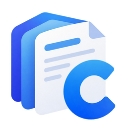
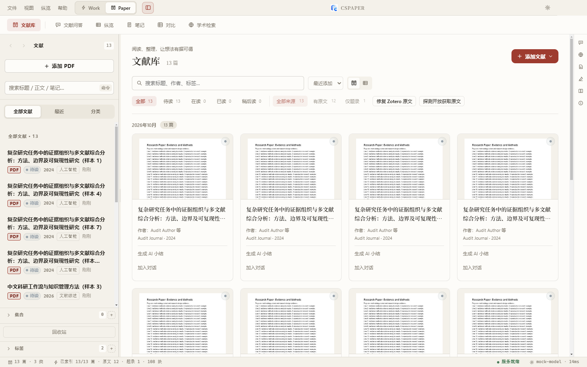
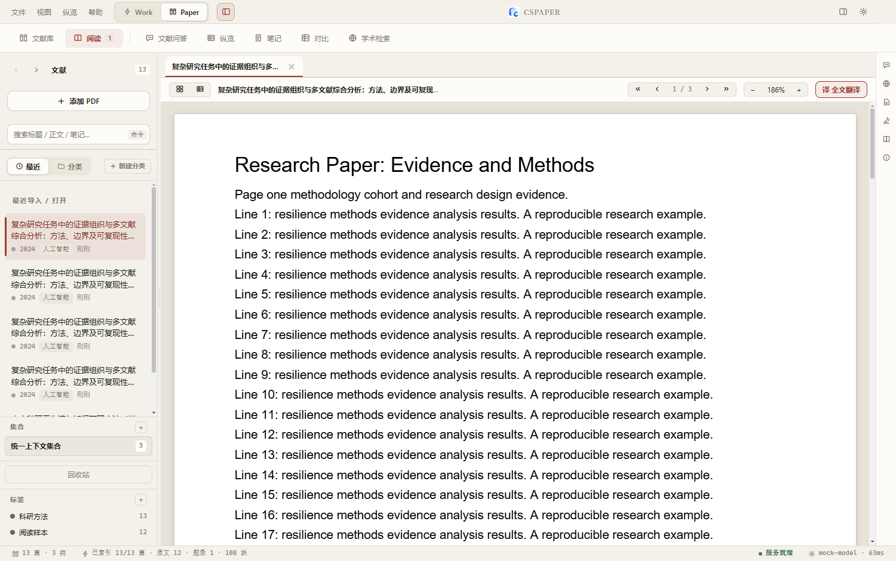
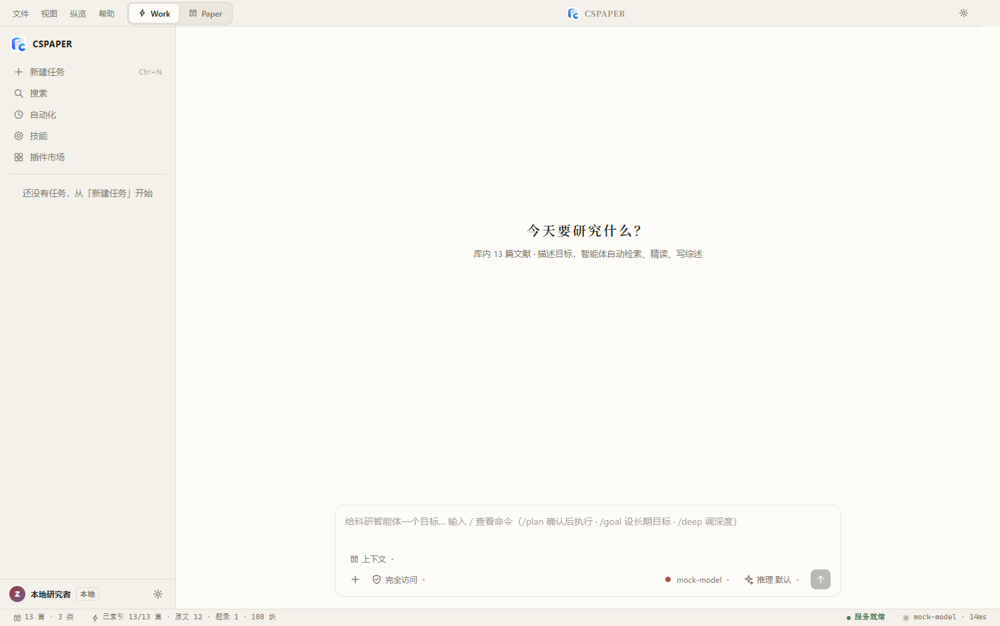
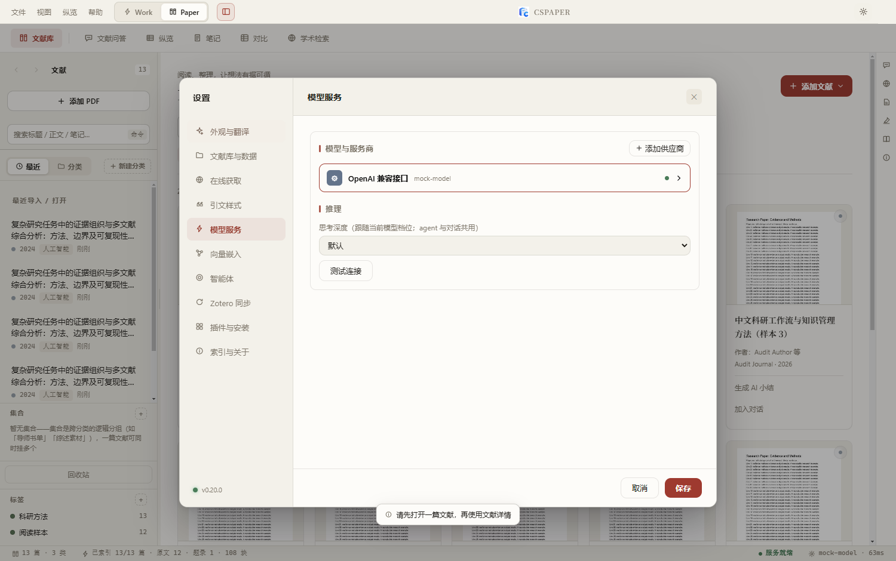
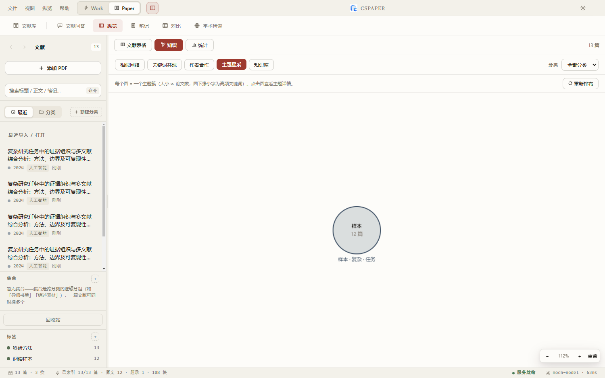
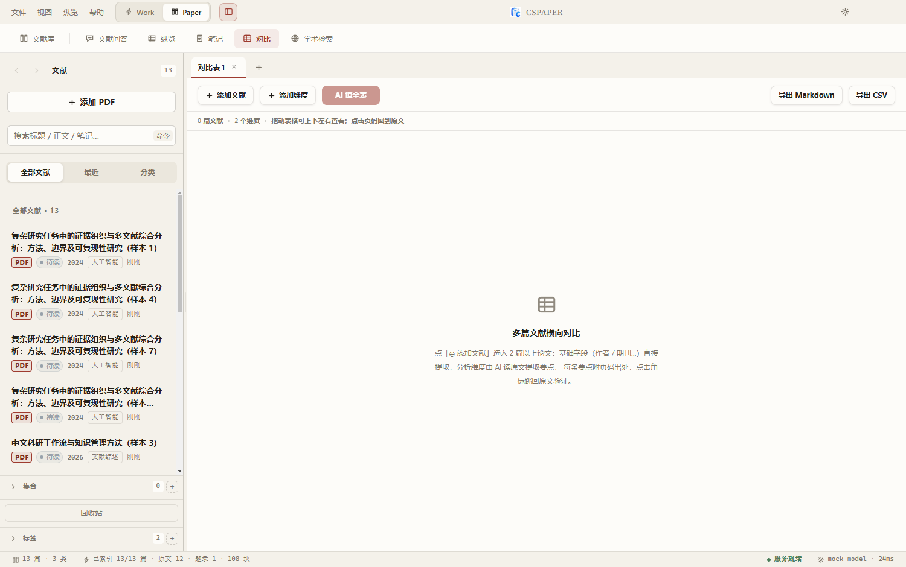

<div align="center">

# <picture><source media="(prefers-color-scheme: dark)" srcset="docs/icon.png"></picture>

# CSPAPER

### 面向中文科研场景的本地 AI 文献工作台

**PDF 精读 · 可溯源问答 · 科研 Agent · 多文献对比 · Zotero 迁移 · 知识网络**

[](https://github.com/Jensen-Yao/CSPAPER/releases)
[](https://github.com/Jensen-Yao/CSPAPER/actions/workflows/ci.yml)
[](LICENSE)
[](https://jensen-yao.github.io/CSPAPER/)

[](https://jensen-yao.github.io/CSPAPER/)

**[🌐 官网 / GitHub Pages](https://jensen-yao.github.io/CSPAPER/)** ·
**[🎮 在线演示](https://jensen-yao.github.io/CSPAPER/demo.html)** ·
**[⬇️ 下载安装包](https://github.com/Jensen-Yao/CSPAPER/releases/latest)** ·
**[📋 实施状态](./docs/IMPLEMENTATION_STATUS.md)**

</div>

---

## 0.20：从“功能堆叠”到可审计的科研工作台

这一版把最核心的科研链路打通为**一个持久化运行引擎**：阅读侧栏、全屏对话、Work Agent、自动化任务和翻译都进入同一套会话、工具、审批、恢复与来源体系。模型回答不再只是聊天文本，而是能落到具体论文、页码、选区、笔记、Web 来源和对比产物。

| 关键能力 | 现在的行为 |
|---|---|
| **可溯源对话** | 回答引用绑定到持久 Source；点击角标跳回论文页并高亮精确文本。代码、公式与已有链接不会被误判成引用。 |
| **题录 / 原文状态** | Zotero 无 PDF 条目明确显示“题录 · 无原文”，不会伪装成全文；显式提问时使用元数据 Source，禁止推断全文结论。 |
| **科研 Agent** | Work 支持计划确认、工具审批、失败修订、重试分支、产物入库与崩溃后恢复。 |
| **多文献对比** | 三篇文献可精确绑定 ID 生成对比表，并把局限追加到对应笔记，重启后可继续追问。 |
| **模型能力档案** | 思考等级跟随当前模型的 `reasoningLevels`，支持 `none / minimal / xhigh / max` 与自定义档位，不再固定四档。 |
| **知识网络** | 相似网络、关键词共现、作者合作图支持鼠标滚轮缩放、空白拖拽平移与一键复位。 |
| **工程可靠性** | 迁移 checksum、WAL 备份、操作日志、单实例、窗口销毁清理、强制崩溃恢复、NSIS 安装/升级/卸载矩阵纳入回归。 |

## 它能做什么

### 📖 阅读与写作

- **PDF 阅读**：多标签、缩略图、目录、页内查找、阅读进度、续读记忆、触控板缩放。
- **划词工具**：高亮、批注、术语翻译、解释、把精确选区加入统一对话。
- **全文翻译**：当前页逐段中英对照，支持跟随翻页；未配置 Key 时仍可使用免费通道。
- **笔记中心**：论文笔记、划词标注、独立笔记、模板、Markdown 导出、思维导图。
- **引文生态**：内置 12 种常用 CSL，可扩展官方万种样式；Word / WPS 引文助手与 BibTeX 导出。

### 🔎 检索与综合

- **论文问答**：当前 PDF / 题录 / 选区 / 笔记 / Web 来源均可成为显式上下文。
- **全库 RAG**：本地向量 + BM25 混合检索，段落级引用可回跳原文。
- **AI 对比表**：自定义维度、页码出处、Markdown / CSV 导出、AI 填全表。
- **知识网络**：相似网络、关键词共现、作者合作、主题星系、知识库五视图。
- **统计仪表盘**：阅读时长、时间线、分类、标题词云与多套学术配色。

### ⚡ Work 科研 Agent

给一个研究目标，CSPAPER 可以检索文献、读取指定页、生成对比表、追加笔记、整理综述、执行平台写入。所有高风险动作都有明确权限边界；工具调用、计划修订和执行结果持久化，可审计、可恢复。

```text
目标 → 模型计划 → 用户确认/修改 → 工具执行 → 来源与产物 → 会话/笔记/对比表
```

### 🧬 Zotero 与中文生态

- 本地 Zotero SQLite 迁移：条目、分类、标签、笔记、PDF、标注与元数据。
- 题录/原文状态显式区分；`从 Zotero 修复原文`按条目 key 精确匹配 storage 附件，替换前自动备份且操作幂等。
- 无 PDF 条目保留为题录并明确标注，拿到原文后替换 `paper.pdf` 即可升级为全文。
- 内置 arXiv、DOI、IEEE、ScienceDirect、Springer、Wiley、PubMed、知网、万方等 13 个站点脚本。
- OpenAlex 被引更新、DOI / arXiv / 链接在线添加、浏览器插件一键保存。

## 界面速览

| 阅读与侧栏问答 | Work 科研 Agent |
|---|---|
|  |  |

| 模型与服务商 | 知识网络 | 对比表 |
|---|---|---|
|  |  |  |

## 下载与安装

| 系统 | 安装包 |
|---|---|
| Windows 10/11 x64 | `CSPAPER Setup <version>.exe` |
| macOS Apple Silicon / Intel | `CSPAPER-<version>-arm64.dmg` / `-x64.dmg` |
| Android 7.0+ | `CSPAPER-Mobile-<version>.apk` |

从 [Releases](https://github.com/Jensen-Yao/CSPAPER/releases/latest) 下载。Windows 首次运行如遇 SmartScreen，选择“仍要运行”；macOS 首次打开可右键应用 →“打开”。

```bash
git clone https://github.com/Jensen-Yao/CSPAPER.git
cd CSPAPER
npm ci
npm run rebuild
npm run dev
```

## 模型配置

CSPAPER 支持任意 OpenAI 兼容接口，并内置智谱、DeepSeek、通义、Kimi、OpenAI、Gemini、OpenRouter、Ollama、LM Studio 等 18+ 预设。每个服务商独立保存 Key、Base URL、模型列表与能力档案；同一模型名可跨服务商精确绑定。思考等级来自每个模型的能力配置，可直接在对话中新增。

默认无需上传数据：嵌入可使用本地 e5-small，也可切换智谱或 Ollama。

## 数据与隐私

- 文献、PDF、SQLite、向量索引、高亮、笔记、会话和工具记录保存在本机。
- 浏览器插件、Word 引文助手与桌面端只通过 `127.0.0.1` 本地桥接通信。
- API Key 存放在本机用户数据目录；本仓库不收集、不上传、不内置任何 Key。
- 文件写入使用操作日志与备份恢复策略，崩溃后进入明确状态而不是静默重放。

## 架构与验证

```text
Renderer App / Work / Reader Sidebar
        ↓ typed preload contract
Chat IPC → Runtime → Provider / Tools / Retrieval
        ↓               ↓
SQLite conversations    Sources / Artifacts
Markdown + CSL + PDF    Operation Journal
```

当前本机发布验收：

| 检查 | 结果 |
|---|---|
| Typecheck | ✅ 通过 |
| Core regression | ✅ 73 / 73 |
| UI regression | ✅ 63 / 63，无 renderer 异常 |
| Packaged app UI | ✅ 63 / 63 |
| Lifecycle / crash | ✅ 单实例、窗口清理、操作崩溃、托盘恢复 |
| Installer 0.20.0 | ✅ 首装、启动、升级、卸载、残留检查；安装包 SHA-256 `D4B01B048ADBFF001BB0C3F99EC8476F06BC214AAAD6B032611A36D2F6B39AAA` |
| Real model | ✅ Agnes 两个模型严格 JSON；三文献任务 7 个工具、3 篇笔记、1 张对比表 |
| 10k library | ✅ list 73.63ms，最大事件循环间隔 74.06ms（低于 100ms 预算） |
| CSS gate | ✅ 圆角 17 档、字号 14 档、important 5 |

更多证据见 [`design-plans/execution-review-2026-10-29/`](./design-plans/execution-review-2026-10-29/)。架构、协议、迁移和当前边界见：

- [ARCHITECTURE.md](./docs/ARCHITECTURE.md)
- [CHAT_PROTOCOL.md](./docs/CHAT_PROTOCOL.md)
- [MIGRATIONS.md](./docs/MIGRATIONS.md)
- [PLAN_ACCEPTANCE.md](./docs/PLAN_ACCEPTANCE.md)
- [IMPLEMENTATION_STATUS.md](./docs/IMPLEMENTATION_STATUS.md)

## 路线图

- Zotero 附件补齐后的真实数据批量修复演练与结果报告。
- 更多真实服务商矩阵。
- CNKI 深度适配、iOS、WebDAV 同步、开放插件系统。
- 真实长会话逐帧性能与无障碍全覆盖。

详见 [ROADMAP.md](./ROADMAP.md)。

## 参与贡献

欢迎 Issue / PR。提交前请运行：

```bash
npm run check
```

涉及安装器或原生模块时，另跑：

```bash
npm run dist:win
npm run test:installer
```

## License

Apache-2.0 License. PDF rendering by Mozilla pdf.js; AI runtime uses Vercel AI SDK; academic metadata uses Crossref / OpenAlex / arXiv public APIs.

<div align="center">

**如果 CSPAPER 让你的文献阅读更高效，欢迎 Star ⭐ 支持继续打磨。**

</div>
